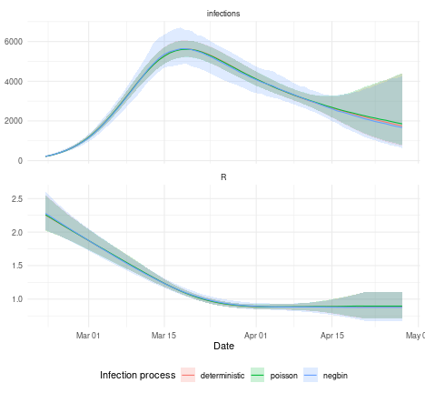

By default the renewal model in `estimate_infections()` treats new infections as deterministic given $R_t$ and past infections.
The `infection_process` argument of `rt_opts()` can instead make new infections stochastic, using a log-normal approximation to a Poisson (`"poisson"`) or negative binomial (`"negbin"`) process.
Here we fit the same data with each option and compare the estimates and run times.
For the model definition see the [model definition](estimate_infections.html) vignette.

# Set up


``` r
library("EpiNow2")
#> Loading required package: distspec
#> 
#> Attaching package: 'distspec'
#> The following objects are masked from 'package:stats':
#> 
#>     Gamma, sd
#> 
#> Attaching package: 'EpiNow2'
#> The following objects are masked from 'package:distspec':
#> 
#>     bound_dist, collapse, convert_to_logmean, convert_to_logsd,
#>     Dirichlet, discretise, discretize, Exp, fix_parameters, Fixed,
#>     Gamma, get_distribution, get_parameters, get_pmf, is_constrained,
#>     LogNormal, new_dist_spec, NonParametric, Normal, Weibull
#> The following object is masked from 'package:stats':
#> 
#>     Gamma
library("data.table")
library("ggplot2")
options(mc.cores = 4)
```

We use the first 60 days of the example data, with the example generation time and delays used in the [estimate_infections() examples](estimate_infections_options.html) vignette.


``` r
reported_cases <- example_confirmed[1:60]
delay <- example_incubation_period + LogNormal(mean = 2, sd = 1, max = 10)
```

# Fitting the models

We fit the model with each infection process, keeping everything else the same.
For the negative binomial process we use the default prior on the overdispersion of new infections, `Normal(mean = 0, sd = 0.1)`.


``` r
processes <- c("deterministic", "poisson", "negbin")
fits <- lapply(processes, function(process) {
  estimate_infections(reported_cases,
    generation_time = gt_opts(example_generation_time),
    delays = delay_opts(delay),
    rt = rt_opts(
      prior = LogNormal(mean = 2, sd = 1),
      infection_process = process
    ),
    stan = stan_opts(seed = 123)
  )
})
names(fits) <- processes
```

# Run times and diagnostics

Stochastic infections add one parameter per time point, which increases run times.
The run times below are from a single run and will vary between machines, so the relative differences are more informative than the absolute values.


``` r
diagnostics <- rbindlist(lapply(processes, function(process) {
  fit <- fits[[process]]$fit
  data.table(
    process = process,
    max_chain_time = max(rowSums(rstan::get_elapsed_time(fit))),
    divergent = rstan::get_num_divergent(fit),
    max_treedepth = rstan::get_num_max_treedepth(fit)
  )
}))
diagnostics[, relative_time := max_chain_time / max_chain_time[1]]
diagnostics
#>          process max_chain_time divergent max_treedepth relative_time
#>           <char>          <num>     <int>         <int>         <num>
#> 1: deterministic         85.551         6             0      1.000000
#> 2:       poisson        120.677         4             0      1.410585
#> 3:        negbin        132.338         4             0      1.546890
```

# Estimates

We compare the estimated reproduction number and infections.


``` r
estimates <- rbindlist(lapply(processes, function(process) {
  summary(
    fits[[process]], type = "parameters", params = c("R", "infections")
  )[, process := process]
}))
estimates[, process := factor(process, levels = processes)]
```


``` r
ggplot(estimates, aes(x = date, fill = process, col = process)) +
  geom_ribbon(aes(ymin = lower_90, ymax = upper_90), alpha = 0.2, col = NA) +
  geom_line(aes(y = median)) +
  facet_wrap(~variable, ncol = 1, scales = "free_y") +
  theme_minimal() +
  theme(legend.position = "bottom") +
  labs(
    x = "Date", y = NULL,
    fill = "Infection process", col = "Infection process"
  )
```



The width of the 90% credible intervals summarises how much extra uncertainty each option adds.


``` r
estimates[,
  .(mean_90_width = mean(upper_90 - lower_90)),
  by = .(variable, process)
]
#>      variable       process mean_90_width
#>        <char>        <fctr>         <num>
#> 1:          R deterministic     0.2095569
#> 2: infections deterministic   954.3161266
#> 3:          R       poisson     0.2099524
#> 4: infections       poisson   961.6167157
#> 5:          R        negbin     0.2365740
#> 6: infections        negbin  1404.3537156
```

For the negative binomial process we can also look at the estimated overdispersion of new infections, and compare it to its prior.


``` r
summary(
  fits[["negbin"]], type = "parameters", params = "infection_overdispersion"
)
#>      date                 variable strat   type     median       mean
#>    <Date>                   <char> <int> <char>      <num>      <num>
#> 1:   <NA> infection_overdispersion    NA   <NA> 0.07665677 0.08486987
#>            sd    lower_90   lower_50   lower_20   upper_20  upper_50  upper_90
#>         <num>       <num>      <num>      <num>      <num>     <num>     <num>
#> 1: 0.05958068 0.006440376 0.03588316 0.06011088 0.09429071 0.1234727 0.1929951
```

# Summary


The deterministic model was the fastest.
The Poisson process took 1.4 times and the negative binomial process 1.5 times as long in this run.
Relative to the deterministic model, the 90% credible intervals were 1.01 times as wide for infections with the Poisson process and 1.47 times as wide with the negative binomial process.
For $R_t$ the ratios were 1 and 1.13.
With case counts in the hundreds to thousands, Poisson noise is small relative to expected infections and so changes the estimates little.
The negative binomial process allows more day-to-day variation, which passes through the renewal equation into later infections.
Here the posterior for its overdispersion is close to the prior, so the data say little about it and an informative prior is advised.
The returned $R_t$ is the expected reproduction number, so it is smoother than the noisy infections.
Growth rates are calculated from the noisy infections, and `rt_opts(growth_method = "infectiousness")` gives smoother growth rates.
Divergent transitions varied between runs for all three options, so check sampler diagnostics whichever option is used.
